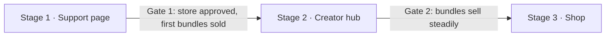

# Creator Support Site: Product Requirements Document

| Field | Value |
| --- | --- |
| Product | Creator Support Site (stage 1: Support page) |
| Owner | Andrei |
| Status | Draft for review |
| Version | 0.2 |
| Date | Oct 17, 2026 |
| Source | [Product Description](Product%20Description.md) |

### Decision log

| Date | Decision |
| --- | --- |
| Oct 17, 2026 | Framework: Next.js 14+ (App Router). Styling: Tailwind CSS. |
| Oct 17, 2026 | The pay-what-you-want price is entered on the Lemon Squeezy checkout page, not on the site. |
| Oct 17, 2026 | Email provider not chosen yet. Stage 1 builds a provider-agnostic signup wrapper with a local stub. |
| Oct 17, 2026 | Domain chosen later. Development and testing run on the local machine first. |
| Oct 17, 2026 | Testing framework: Playwright for end-to-end, mobile, accessibility and visual tests. |

---

## 1. Summary

A personal creator site where Medium readers support Andrei by buying small pay-what-you-want digital products (article bundles: a PDF edition plus a one-page cheat sheet). Checkout runs through Lemon Squeezy, a merchant-of-record provider that pays out to Montenegro. Stage 1 is one mobile-first scrolling page. Its domain, routes, data model, payment layer and design system are built so the site can grow into a creator hub (stage 2) and a digital-product shop (stage 3) without a rebuild.

## 2. Problem statement

- Medium Partner Program payouts and Buy Me a Coffee both rely on Stripe, which does not support sellers in Montenegro. Andrei has no working way to receive money from readers.
- Merchant-of-record providers that do pay out to Montenegro (Lemon Squeezy, Paddle) forbid pure donations. Every payment must buy a real product.
- Readers who want to support Andrei arrive on a phone, often from the Medium app, and leave if the path to paying is slow or confusing.

**Product response:** replace the tip jar with "get something useful, name your price." Each payment buys a real convenience product built from a free article.

## 3. Goals, success metrics and non-goals

### 3.1 Stage 1 goals

| ID | Goal |
| --- | --- |
| G1 | Receive reader support through a provider that pays out to Montenegro. |
| G2 | Introduce Andrei and what readers get from his articles. |
| G3 | Show which articles bring in supporters. |
| G4 | Lay the foundations (domain, routes, data model, design system) for the hub and shop. |
| G5 | Serve as a hands-on learning project for AI-assisted development with Claude Code. |

### 3.2 Success metrics

The headline criterion: **a reader can go from the end of a Medium article to a completed purchase in under a minute on a phone.**

| Metric | Target | How measured | Goal |
| --- | --- | --- | --- |
| Time from landing to completed purchase (mobile) | < 60 s for a first-time buyer | Moderated test on a real phone with the live checkout in test mode; repeated after launch | G1 |
| Store approved by Lemon Squeezy | Yes, before launch | Provider dashboard | G1 |
| First bundles sold | ≥ 1 real sale (stage 2 gate) | Lemon Squeezy orders | G1 |
| Sales attributed to an article | 100% of sales from UTM-tagged links carry an article slug | Lemon Squeezy order custom data | G3 |
| `checkout_click` events attributed to an article | Reported per `utm_campaign` in GA4 | GA4 key event report | G3 |
| Support block position | Starts within the first two screen heights on a 390 × 844 viewport | Visual check, automated test | G1 |
| Mobile performance | LCP ≤ 2.5 s, CLS ≤ 0.1, INP ≤ 200 ms (field or lab on mid-range phone, 4G) | Lighthouse, PageSpeed Insights | G1 |
| Design system coverage | 100% of page UI built from defined tokens and components | Code review | G4 |

The proposed targets for performance and attribution are assumptions to validate; the source document only fixes the one-minute criterion.

### 3.3 Non-goals for stage 1

- A full shop, user accounts or a members area.
- Hosting articles on the site.
- Subscriptions or recurring memberships.
- Languages other than English (the site must still be translation-ready, see NFR-I18N).
- Heavy SEO work beyond the basics in section 9.
- Accepting donations or tips of any kind.

## 4. Users

### 4.1 Primary persona: the warm reader

- **Who:** a beginner or practitioner who wants to build useful things with Python and AI. A smaller group is interested in data architecture and governance.
- **Context:** has just finished one of Andrei's Medium articles and tapped the support link at its end. Usually on a phone, often inside the Medium app's in-app browser.
- **Already knows:** Andrei's writing and tone. Doesn't need persuading from scratch.
- **Needs from the page:**
  1. Confirmation they're in the right place (same name and face as the Medium byline, a reference to the article they just read).
  2. A quick sense of what they get for their money.
  3. A checkout with almost no friction.

### 4.2 Secondary personas

| Persona | Arrives from | Needs | Priority in stage 1 |
| --- | --- | --- | --- |
| Curious newcomer | Search, LinkedIn, a shared link | Who Andrei is, which articles to start with | Low (grows in stage 2) |
| Returning reader | Email notification, bookmark | New bundles, new articles | Low |
| Provider reviewer | Lemon Squeezy store review | Clear products, legal pages, no donation language | High (blocks launch) |
| Andrei (admin) | Lemon Squeezy and GA4 dashboards | Which articles bring supporters; easy way to add a bundle | Medium |

### 4.3 Key user journeys

**J1. Article reader buys a bundle (core journey)**

```mermaid
sequenceDiagram
  actor R as Reader (phone)
  participant M as Medium article
  participant S as Site
  participant LS as Lemon Squeezy
  R->>M: Finishes article, taps support link (UTM-tagged)
  M->>S: Opens /?utm_source=medium&utm_medium=article&utm_campaign=<slug>
  S-->>R: Hero + greeting referencing the article
  R->>S: Scrolls or taps "Grab a cheat sheet" to #support
  R->>S: Taps "Get the bundle" on a bundle card
  S->>S: Fires checkout_click {article, bundle} (if consented)
  S->>LS: Opens checkout with custom data article=<slug>
  R->>LS: Enters price on checkout page (≥ minimum), pays
  LS-->>R: Redirects to thank-you page; emails receipt and download link
```

**J2. Reader changes their mind:** closes or abandons checkout and sees the "Checkout cancelled" message, with the articles still one tap away.

**J3. Reader signs up for new-article emails:** enters an email in "Stay in touch," sees success or validation error inline.

**J4. Visitor declines cookies:** taps "No thanks"; GA4 does not set cookies; everything else works the same, including checkout.

**J5. Visitor hits a broken link:** sees the terminal-style 404 with the confused avatar and a button back to the home page.

## 5. Scope

### 5.1 In scope (stage 1)

- One scrolling home page with six sections: Hero, Support block, About, Featured articles, Stay in touch, Footer.
- 2 to 3 article bundles sold at pay-what-you-want prices via Lemon Squeezy.
- Article-aware greeting driven by `utm_campaign`.
- Thank-you page, checkout-cancelled state, 404 page.
- Legal pages: privacy policy, terms of sale, refund policy.
- Cookie consent bar and GA4 with Consent Mode.
- Email signup for new-article notifications.
- Design system as code (tokens and core components).
- Products data model, payment abstraction layer, content files.
- Reserved routes for future pages.
- Own domain, HTTPS, Vercel hosting.

### 5.2 Out of scope (stage 1)

Everything in section 3.3, plus: product pages per bundle, a newsletter beyond new-article notifications, a "start here" path, an `/articles` hub, discounts and upsells, and the bundle-generation Python utility (a separate project, see section 14).

## 6. Functional requirements

Priority uses MoSCoW: **M** must, **S** should, **C** could. All user-facing text comes from content files (see NFR-I18N); the copy in section 7 is the starting text.

### 6.1 Global layout and navigation

| ID | Requirement | Priority | Acceptance criteria |
| --- | --- | --- | --- |
| FR-NAV-1 | A header shows the name/brand and 2 to 3 navigation links at launch (e.g. Support, About, Articles). | M | Links scroll to `/#support`, `/#about`, `/#articles`. Header layout supports up to 5 links without redesign. |
| FR-NAV-2 | Header stays usable on a 320 px wide screen. | M | No horizontal scroll, no wrapped or truncated links at 320 px. |
| FR-NAV-3 | Anchor navigation scrolls smoothly and lands with the section heading visible (not hidden under a sticky header). | S | Verified on iOS Safari and Android Chrome. Respects `prefers-reduced-motion`. |
| FR-NAV-4 | Reserved routes `/support`, `/about`, `/articles`, `/shop` resolve today. | M | Each redirects (temporary, 302/307) to the matching home anchor (`/shop` → `/#support`). Redirects are changed to real pages in later stages without breaking shared links. |

### 6.2 Hero (section 1)

| ID | Requirement | Priority | Acceptance criteria |
| --- | --- | --- | --- |
| FR-HERO-1 | Shows illustrated avatar (waving pose), Andrei's name, tagline, one-line promise and calls to action. | M | All elements visible above the fold on 390 × 844. Name matches the Medium byline. |
| FR-HERO-2 | Primary CTA "Grab a cheat sheet" jumps to `#support`. Secondary "Read the articles" jumps to `#articles`. | M | Primary uses the dark primary button; secondary is visually subordinate. |
| FR-HERO-3 | Avatar image is optimized and has meaningful alt text. | M | Served in a modern format at responsive sizes; does not cause layout shift. |

### 6.3 Referral greeting

| ID | Requirement | Priority | Acceptance criteria |
| --- | --- | --- | --- |
| FR-REF-1 | When `utm_campaign` matches a known article slug, the page shows a one-line greeting with that article's title. | M | Greeting uses the "Fresh from…" copy with the title looked up from the articles content file. |
| FR-REF-2 | Unknown, missing or malformed `utm_campaign` shows no greeting and no error. | M | Raw query text is never rendered on the page (prevents injection and odd text). |
| FR-REF-3 | If the referring article has a bundle, that bundle card is highlighted or shown first. | S | Order of other bundles unchanged. |
| FR-REF-4 | The article slug is kept for the session so it still reaches checkout after in-page navigation. | M | Stored in memory or `sessionStorage` (no cookie, so no consent needed); cleared when the tab closes. |

### 6.4 Support block (section 2)

| ID | Requirement | Priority | Acceptance criteria |
| --- | --- | --- | --- |
| FR-SUP-1 | Section has id `support` and starts within the first two screen heights on a phone. | M | Top of the section ≤ 1688 px from page top at 390 × 844. |
| FR-SUP-2 | Shows heading, short intro explaining why (Montenegro, no tip jar) and the free-content note. | M | Copy from section 7. No words "donate," "donation," "tip" or "sponsor" as the action being paid for. |
| FR-SUP-3 | Shows 2 to 3 bundle cards rendered from the products data. | M | Adding a product to the data file adds a card with no page code change. |
| FR-SUP-4 | Each card shows: product name, article title, what's inside, who it helps, a cheat-sheet preview (terminal style), a price hint with minimum and suggested price, and the "Get the bundle" button. | M | Prices read from product data and formatted with currency symbol. Nothing hard-coded. The card has no price input. |
| FR-SUP-5 | Pay-what-you-want: the buyer enters the price on the Lemon Squeezy checkout page. The product's minimum and suggested price are configured in Lemon Squeezy, and the same values are mirrored in the products data file for the card hint. | M | Lemon Squeezy rejects amounts below the minimum and pre-fills the suggested price. Card hint values match the provider config (checked before go-live). |
| FR-SUP-6 | "Get the bundle" opens the Lemon Squeezy checkout for that product, carrying the article slug (from referral or the bundle's own article) as custom data. | M | Order in Lemon Squeezy shows `article` and `bundle` custom fields. |
| FR-SUP-7 | Checkout works on phones, including the Medium in-app browser. | M | Tested on iOS and Android, in-app browser and default browser. If the overlay checkout fails in-app, fall back to the hosted checkout page. |
| FR-SUP-8 | When there are no live products or a slot is empty, show the placeholder card "New bundle cooking. Check back soon." | M | Placeholder cards have no checkout button. |
| FR-SUP-9 | Placeholder products are used in local and preview environments; live products only in production. | M | Environment config selects test-mode or live product IDs. |

### 6.5 Checkout outcome pages

| ID | Requirement | Priority | Acceptance criteria |
| --- | --- | --- | --- |
| FR-CO-1 | Thank-you page at `/thanks` (avatar holding coffee) confirms payment and says the download link is on its way by email. | M | Lemon Squeezy redirect URL after purchase points here. Page is `noindex`. |
| FR-CO-2 | Thank-you page links back to the articles and the email signup. | S | — |
| FR-CO-3 | Checkout cancelled state shows "Changed your mind? No hard feelings…" | S | Shown when the buyer closes the overlay or returns without paying; does not block the page. |
| FR-CO-4 | Product files are delivered by Lemon Squeezy (receipt email and order page). | M | Test purchase in test mode delivers both PDF and cheat sheet. |

### 6.6 About the author (section 3)

| ID | Requirement | Priority | Acceptance criteria |
| --- | --- | --- | --- |
| FR-ABOUT-1 | Section `#about` leads with what readers get from the articles, then a short career line. | M | Order: reader value first, career second. |
| FR-ABOUT-2 | Shows 2 to 3 topic tags as tilted stickers (e.g. Python, AI, Data architecture & governance). | M | Data architecture appears only as a tag, never in a headline. |
| FR-ABOUT-3 | Links to Medium and LinkedIn profiles. | S | Open in a new tab with `rel="noopener"`. |

### 6.7 Featured articles (section 4)

| ID | Requirement | Priority | Acceptance criteria |
| --- | --- | --- | --- |
| FR-ART-1 | Section `#articles` shows 3 article cards from the articles content file. | M | Each card: title, one-line summary, topic tag, optional image, "Read on Medium" button. |
| FR-ART-2 | Card links go to the Medium article. | M | Links open in a new tab. Placeholder cards used until articles are chosen. |
| FR-ART-3 | If an article has a bundle, its card shows a small link to that bundle. | C | Link jumps to the bundle card in `#support`. |

### 6.8 Stay in touch (section 5)

| ID | Requirement | Priority | Acceptance criteria |
| --- | --- | --- | --- |
| FR-SIGN-1 | One-field email form with heading, helper text and "Notify me" button. | M | Label is accessible (visible or programmatic). |
| FR-SIGN-2 | Client and server validate email format. | M | Invalid input shows the signup error copy inline; no page reload. |
| FR-SIGN-3 | A valid submission goes through the provider-agnostic signup wrapper (section 8.5) and shows the success copy. | M | Form and API route call only the wrapper. Until a provider is chosen, a local stub accepts the signup and logs it in development. Duplicate submissions show success. |
| FR-SIGN-4 | Once a provider is connected, signup uses double opt-in and records consent (timestamp, source). | M (before go-live) | Confirmation email sent; unconfirmed addresses receive nothing else. Required for EU consent. Not needed while the stub is in use. |
| FR-SIGN-5 | Form is protected against spam without a visible CAPTCHA. | S | Honeypot field and rate limiting on the endpoint. |
| FR-SIGN-6 | Helper text links to the privacy policy. | M | — |

### 6.9 Footer (section 6)

| ID | Requirement | Priority | Acceptance criteria |
| --- | --- | --- | --- |
| FR-FOOT-1 | Footer on every page shows contact, Medium and LinkedIn links, the footer line, and links to privacy, terms and refunds. | M | Present on home, thank-you, legal and 404 pages. |
| FR-FOOT-2 | Footer includes a "Cookie settings" link that reopens the consent bar. | M | Lets visitors change their choice (GDPR requirement). |

### 6.10 Cookie consent

| ID | Requirement | Priority | Acceptance criteria |
| --- | --- | --- | --- |
| FR-CONS-1 | A small bottom bar in the notebook style asks for analytics consent with "Fine by me" and "No thanks." | M | Never a full-screen modal. Never covers the support block's "Get the bundle" buttons (page gets bottom padding while the bar is shown). |
| FR-CONS-2 | GA4 loads with Google Consent Mode v2 defaults set to denied; analytics storage is granted only after "Fine by me." | M | No GA cookies set before consent (verified in browser dev tools). |
| FR-CONS-3 | The choice is remembered and the bar is not shown again until the choice expires or is reset. | M | Choice stored for up to 12 months (assumption, confirm in legal review). |
| FR-CONS-4 | The bar is shown to visitors from the EU/EEA (and the UK). | M | Simplest compliant option: show to everyone. Geo-targeting is a *could*. |
| FR-CONS-5 | Checkout and signup work whether or not consent is given. | M | Tested with "No thanks." |

### 6.11 Legal pages

| ID | Requirement | Priority | Acceptance criteria |
| --- | --- | --- | --- |
| FR-LEGAL-1 | Pages `/privacy`, `/terms`, `/refunds` exist before store review. | M | Linked from every footer. |
| FR-LEGAL-2 | Privacy policy covers GA4 cookies, email signup and data shared with the payment provider. | M | Names each processor (Google, Lemon Squeezy, email provider, Vercel). |
| FR-LEGAL-3 | Terms and refund policy match Lemon Squeezy's merchant-of-record terms for digital goods. | M | Reviewed side by side with provider terms. |
| FR-LEGAL-4 | Final texts checked against Montenegrin and EU requirements by a qualified reviewer. | M | Sign-off recorded before go-live. |

### 6.12 404 page

| ID | Requirement | Priority | Acceptance criteria |
| --- | --- | --- | --- |
| FR-404-1 | Unknown URLs return HTTP 404 with a terminal-style page, the confused avatar, the 404 copy, and the "Back to the useful part" button. | M | Button goes to `/`. Page is `noindex`. |

### 6.13 Admin and operations

| ID | Requirement | Priority | Acceptance criteria |
| --- | --- | --- | --- |
| FR-ADM-1 | Andrei adds or edits a bundle by editing the products data file and uploading files in Lemon Squeezy. | M | Documented in a short README; no code change needed. |
| FR-ADM-2 | Andrei can see sales per article. | M | Lemon Squeezy order export includes `article`; GA4 shows `checkout_click` by `article`. |
| FR-ADM-3 | A Lemon Squeezy webhook endpoint receives `order_created` events, verifies the signature and logs order ID, product, amount and article. | S | Invalid signatures rejected with 401. Lives in the payment module. |

## 7. Content and microcopy

Voice rules: more value, less padding; beginner-friendly, no jargon; humorous and sometimes sarcastic, like Andrei's articles. Personality lives in microcopy. All drafts below need Andrei's review before launch.

**Tagline:** "DIY with me: useful things built with Python and AI, every step included." (Recommended. Alternatives in the product description.)

| Content key | Placement | Copy |
| --- | --- | --- |
| `hero.headline` | Hero headline | Useful things you can build this weekend. |
| `hero.subhead` | Hero subhead | Step-by-step guides on Python and AI, written so you can finish the job without opening five other tutorials. |
| `hero.ctaPrimary` / `hero.ctaSecondary` | Hero buttons | Grab a cheat sheet · Read the articles |
| `referral.greeting` | Greeting for visitors from an article | Fresh from "{article title}"? The cheat-sheet version is right below. You've earned it. |
| `support.heading` | Support heading | Support my writing and get something useful back |
| `support.intro` | Support intro | Medium can't pay me: its payment provider doesn't do Montenegro. So instead of a tip jar, here's a deal. You name the price, I send you the PDF and the cheat sheet. Everyone wins, especially my coffee machine. |
| `support.freeNote` | Free-content note | Every article stays free on Medium. The bundle just saves you the scrolling. |
| `product.cardTemplate` | Bundle card | {Article title}: PDF + cheat sheet. The full article as a clean PDF, plus one page with just the steps and commands. |
| `product.priceHint` | Price hint on bundle card (price is entered at checkout) | Name your price at checkout. Minimum {min}, suggested {suggested}. Paying more is allowed and deeply appreciated. |
| `product.cta` | Checkout button | Get the bundle |
| `product.placeholder` | Bundle placeholder | New bundle cooking. Check back soon. |
| `about.heading` | About heading | Who's writing this |
| `about.intro` | About intro | I'm Andrei. For 25+ years I've designed data systems for banks and large companies, where "it mostly works" gets you a very long meeting. Now I write guides on building useful things with Python and AI, every step included, because I can't stand tutorials that skip the hard part. |
| `articles.heading` | Featured heading | Start with these |
| `articles.cta` | Featured card button | Read on Medium |
| `signup.heading` | Signup heading | Get new guides by email |
| `signup.helper` | Signup helper | One email when a new article is out. No spam, no weekly digest I'd forget to write. |
| `signup.cta` | Signup button | Notify me |
| `signup.success` | Signup success | You're on the list. See you at the next article. |
| `signup.error` | Signup error | That doesn't look like an email address. Try again, I'll wait. |
| `consent.text` / `consent.accept` / `consent.decline` | Cookie consent bar | Cookies, but only the boring analytics kind. They tell me which articles bring you here. · Fine by me · No thanks |
| `checkout.cancelled` | Checkout cancelled | Changed your mind? No hard feelings. The articles are still free. |
| `thanks.body` | Thank-you page | Payment received. My coffee machine thanks you personally. The download link is on its way to your inbox. |
| `notFound.body` / `notFound.cta` | 404 page | This page doesn't exist. Unlike my articles, it skipped the details. · Back to the useful part |
| `footer.line` | Footer | Made with Python, AI, and an unreasonable amount of coffee. |

**Copy compliance rule:** copy may mention coffee as a joke but must always frame the payment as buying a product. The reviewer persona (section 4.2) must never read the page as a donation page.

## 8. Products and payments

### 8.1 Product rules

1. A bundle is a convenience version of a free article: saved time and polish, never missing information. Articles stay complete on Medium.
2. Each bundle is described as a product: what's inside and who it helps.
3. Pay-what-you-want with a minimum and a suggested price, both configured per product.
4. Launch with 2 to 3 bundles from the best-performing articles; placeholders during development.
5. Bundles are generated from the article's Markdown source (PDF + cheat sheet), ideally by a small Python utility (separate project).

### 8.2 Data model

Products are the core entity so the stage 3 shop adds products, not a second system. Stored as typed content files (e.g. JSON/YAML/TS) in the repository at stage 1.

**Product**

| Field | Type | Notes |
| --- | --- | --- |
| `id` | string | Stable internal ID, e.g. `bundle-python-scraper`. |
| `slug` | string | URL-safe; used for future `/shop/<slug>`. |
| `type` | enum | `bundle` at stage 1; later `guide`, `template`, `course`… |
| `status` | enum | `placeholder`, `draft`, `live`, `retired`. |
| `title` | string (content key) | Display name. |
| `summary` | string (content key) | What's inside. |
| `audience` | string (content key) | Who it helps. |
| `includes` | list | e.g. `["PDF edition", "One-page cheat sheet"]`. |
| `articleSlug` | string, optional | Link to the source article. |
| `pricing.model` | enum | `pay_what_you_want` (later `fixed`). |
| `pricing.currency` | ISO 4217 | e.g. `USD` or `EUR` (open question). |
| `pricing.minimum` | integer (minor units) | Display only. Lemon Squeezy enforces the real minimum, so this must match the provider config. |
| `pricing.suggested` | integer (minor units) | Display only. Must match the provider config. |
| `preview` | object | Cheat-sheet snippet or image for the card. |
| `image` | path, optional | Cover image. |
| `provider.name` | enum | `lemonsqueezy` (fallback `paddle`). |
| `provider.productId` / `provider.variantId` | string | Per environment (test/live). |
| `sortOrder` | integer | Card order. |

**Article** (stage 1: featured and referral lookup only)

| Field | Type | Notes |
| --- | --- | --- |
| `slug` | string | Must equal the `utm_campaign` value used on Medium. |
| `title` | string | As on Medium. |
| `summary` | string | One line for the card. |
| `mediumUrl` | URL | Canonical article. |
| `topics` | list | Tag values. |
| `featured` | boolean | Shown in "Start with these." |
| `image` | path, optional | Card image. |
| `publishedAt` | date | For ordering. |

**Signup** is held by the email provider once one is chosen, not by the site: email, consent timestamp, source (`home`, `thanks`), referral article if known, confirmation status. The local stub keeps nothing permanently.

**Order** is held by Lemon Squeezy: the site never stores card data. If FR-ADM-3 is built, the webhook log keeps order ID, product ID, amount, currency, article slug and timestamp, and no buyer personal data beyond what's needed.

### 8.3 Payment abstraction layer

All provider-specific code lives in one module (e.g. `lib/payments/`). Pages call only its interface.

| Function | Purpose |
| --- | --- |
| `getCheckoutUrl(product, { article, bundle })` | Builds the provider checkout URL with custom data and redirect URL. |
| `openCheckout(product, context)` | Opens the overlay where supported, otherwise navigates to the hosted checkout. |
| `verifyWebhook(request)` | Checks the signature. |
| `parseOrderEvent(payload)` | Normalizes a provider event to an internal `Order` shape. |

Provider credentials and product IDs come from environment variables, never from page code. Switching to Paddle means a new implementation of this interface plus updated product IDs.

### 8.4 Provider requirements (Lemon Squeezy)

- Store created, verified and approved before go-live.
- Before applying, describe the bundle model to Lemon Squeezy support and get written confirmation that it's accepted.
- Each bundle is a product with pay-what-you-want enabled, minimum and suggested price set, and both files attached. The buyer enters the price on the Lemon Squeezy checkout page. The site never sends a custom price.
- Article slug passed as checkout custom data (`checkout[custom][article]`, `checkout[custom][bundle]`).
- Redirect after purchase set to `https://<domain>/thanks`.
- Test mode used in local and preview environments.
- Paddle remains the documented fallback if the store is rejected.

### 8.5 Signup wrapper

The email provider isn't chosen yet, so stage 1 defines only a thin, provider-agnostic wrapper (e.g. `lib/signup/`), built the same way as the payment layer. The form and the `/api/subscribe` route depend only on this interface.

```ts
type SignupSource = "home" | "thanks";

interface SignupRequest {
  email: string;
  source: SignupSource;
  article?: string;      // referral slug, if known
  consentAt: string;     // ISO timestamp of submission
}

type SignupResult =
  | { ok: true; status: "subscribed" | "pending_confirmation" | "already_subscribed" }
  | { ok: false; error: "invalid_email" | "rate_limited" | "provider_error" };

interface SignupProvider {
  subscribe(req: SignupRequest): Promise<SignupResult>;
}
```

- **Stage 1 implementation:** a `StubSignupProvider` that validates the email, logs the request to the server console in development, and returns `subscribed`. Nothing is stored or sent.
- **Selection:** the provider is chosen by an environment variable (e.g. `SIGNUP_PROVIDER=stub`), so connecting a real provider later means adding one implementation and changing config, not touching the form.
- **Before go-live:** a real provider is connected (Q3), and FR-SIGN-4 (double opt-in, consent record) is met. Alternatively the signup section stays hidden at launch.

## 9. SEO

Stage 1 covers solid basics; heavier SEO starts with the stage 2 articles hub.

| ID | Requirement | Priority |
| --- | --- | --- |
| SEO-1 | Unique `<title>` and meta description per indexable page. | M |
| SEO-2 | Open Graph and Twitter card tags with a designed social preview image (1200 × 630). | M |
| SEO-3 | Clean URLs, HTTPS only, single canonical host (www or apex, the other redirects). | M |
| SEO-4 | `sitemap.xml` and `robots.txt`; thank-you and 404 pages excluded and `noindex`. | M |
| SEO-5 | JSON-LD `Person` structured data for Andrei (name, image, `sameAs` Medium and LinkedIn). | M |
| SEO-6 | JSON-LD `Product` structured data for bundles. | C (stage 3) |
| SEO-7 | Canonical URL tag strips UTM parameters. | M |
| SEO-8 | Every Medium article links to the site with its own UTM-tagged URL. | M |

## 10. Analytics and referral tracking

### 10.1 Setup

- Google Analytics 4 from day one (host-independent, no plan dependency). Vercel Web Analytics is not used.
- Google Consent Mode v2, defaults denied, updated on consent (FR-CONS-2).

### 10.2 UTM convention

Every Medium support link uses:

```
https://<domain>/?utm_source=medium&utm_medium=article&utm_campaign=<article-slug>#support
```

`<article-slug>` must exist in the articles content file. A short helper (script or page in the README) generates these links to avoid typos.

### 10.3 Events

| Event | When | Parameters | Key event |
| --- | --- | --- | --- |
| `page_view` | Automatic | GA4 defaults including UTM | No |
| `checkout_click` | "Get the bundle" tapped | `article` (referral slug or `none`), `bundle` (product id) | **Yes** |
| `sign_up` | Signup accepted | `method: "email"` | S |
| `checkout_cancelled` | Overlay closed without purchase | `bundle` | C |

Purchase revenue is reported from Lemon Squeezy, not GA4, at stage 1. Sending a server-side `purchase` event from the webhook is a *could*.

### 10.4 Reporting needs

- Visitors, `checkout_click` and sales per article slug.
- Conversion from landing to `checkout_click` for Medium traffic.

## 11. Design system

Design system first: tokens and core components are defined before any page is built, live in one place in code, and are the only building blocks pages use. Claude Code is pointed at this module when building each page.

**Implementation with Tailwind CSS:**
- Tokens are defined once as CSS custom properties (e.g. in `app/globals.css`) and mapped into the Tailwind theme in `tailwind.config.ts` (`colors`, `fontFamily`, `fontSize`, `spacing`, `borderRadius`, `boxShadow`, `rotate`, `screens`).
- Pages and components use only theme utilities (`bg-paper`, `text-ink`, `rotate-sticker`…). Arbitrary values (`bg-[#f5f0e6]`, `p-[13px]`) are not allowed outside the design-system module.
- Core components live in `components/ui/` as React components styled with Tailwind; page sections compose them and add no new visual styles.
- A dev-only `/design` page renders every token and component for review. It's excluded from production builds or set to `noindex`.

### 11.1 Visual direction

**Sticker notebook (everything except code)**
- Warm off-white paper background, dark ink text.
- One readable sans-serif for body and headings.
- Highlighter marks on key phrases.
- Rounded sticker-like tags with a slight tilt for topics and products.
- A handwritten accent font only for short asides ("psst, start here"), never for body text.
- A dark, rounded primary button.

**Friendly terminal (code only)**
- Code snippets, cheat-sheet previews and the 404 page use a dark monospace style.
- Jokes appear as code comments, keeping the no-jargon promise.

**Illustrated avatar**
- AI-assisted illustration from Andrei's real photo; must stay recognizable to Medium and LinkedIn readers.
- Poses: waving (hero), holding coffee (thank-you), confused (404).

### 11.2 Required tokens and components

| Kind | Items |
| --- | --- |
| Color tokens | paper, ink, ink-muted, highlighter, sticker accents (2 to 3), terminal background, terminal text, terminal comment, focus ring, error, success |
| Type scale | Sans body and heading sizes (mobile and desktop), handwritten accent, monospace |
| Spacing scale | Single scale used for all margins, paddings and gaps |
| Other tokens | Radii, shadows (sticker), tag tilt angles, breakpoints, motion durations |
| Components | Button (primary, secondary), Card, Tag/sticker, Product tile, Code block / terminal, Highlight mark, Handwritten aside, Section heading, Email field, Consent bar, Avatar |

All color pairs used for text meet WCAG AA contrast (4.5:1 body, 3:1 large text and UI). Highlighter and tilt effects never reduce legibility.

## 12. Non-functional requirements

| ID | Area | Requirement |
| --- | --- | --- |
| NFR-PERF | Performance | Mobile-first. Core Web Vitals "good" on a mid-range phone over 4G (LCP ≤ 2.5 s, CLS ≤ 0.1, INP ≤ 200 ms). Static rendering of all pages (Next.js React Server Components by default, client components only where needed: consent bar, signup form, checkout button, referral greeting); fonts self-hosted through `next/font`; images through `next/image`; GA4 and Lemon Squeezy scripts loaded with `next/script` without blocking first render. |
| NFR-A11Y | Accessibility | WCAG 2.2 AA: semantic landmarks and headings, keyboard operable, visible focus, labels on form fields, alt text, `prefers-reduced-motion` respected, touch targets ≥ 44 × 44 px. |
| NFR-COMPAT | Compatibility | Latest two versions of iOS Safari, Android Chrome, desktop Chrome, Firefox, Safari, Edge; Medium in-app browser on iOS and Android. Layout from 320 px wide. |
| NFR-SEC | Security | HTTPS everywhere with HSTS; secrets only in environment variables; webhook signature verification; input validation on the signup endpoint; security headers (CSP allowing only GA4, Lemon Squeezy and the email provider, `X-Content-Type-Options`, `Referrer-Policy`). |
| NFR-PRIV | Privacy | No analytics cookies before consent; no card data touches the site; minimal personal data; processors listed in the privacy policy. |
| NFR-I18N | Translation-ready | English only, but every user-facing string lives in content files keyed as in section 7, so a second language can be added without touching components. |
| NFR-PORT | Portability | No Vercel-only features (no `@vercel/analytics`, Vercel KV, Edge Config, etc.). The app runs with `next build && next start` on any Node.js host, and on the local machine. Moving host requires only deployment config changes. |
| NFR-MAINT | Maintainability | Adding a bundle or featured article is a content-file change. Design tokens and components in one module. Short README covering setup, env vars, adding products and generating UTM links. |
| NFR-TEST | Testability | Every *must* requirement with a browser-observable acceptance criterion has a Playwright test (section 13.5). Interactive elements have stable accessible names or `data-testid` attributes. |
| NFR-REL | Reliability | Static pages served from CDN. If the email provider or webhook is down, the rest of the page and checkout keep working. |

## 13. Technical architecture

### 13.1 Decisions fixed now

1. **Own domain before public launch.** Permanent address; the name must not mention coffee, tips or donations. Chosen later. Until then the site runs on the local machine (and optionally Vercel preview URLs). The site URL is read from an environment variable (`NEXT_PUBLIC_SITE_URL`), so no domain is hard-coded.
2. **Routes planned now.** Launch uses anchors (`/#support`, `/#about`, `/#articles`); `/support`, `/about`, `/articles`, `/shop` are reserved (FR-NAV-4).
3. **Support items are products in the data model** (section 8.2).
4. **Payment provider behind a thin abstraction layer** (section 8.3).
5. **Design system as code** (section 11).

### 13.2 Route map

| Route | Stage 1 | Stage 2 | Stage 3 |
| --- | --- | --- | --- |
| `/` | Full scrolling page | Home with previews | Home with previews |
| `/support` | → `/#support` | → `/#support` or own page | → `/shop` |
| `/about` | → `/#about` | Full story page | Same |
| `/articles` | → `/#articles` | Articles hub | Same |
| `/shop` | → `/#support` | → `/#support` | Shop with product pages `/shop/<slug>` |
| `/thanks` | Thank-you page | Same | Same |
| `/privacy`, `/terms`, `/refunds` | Legal pages | Same | Same |
| `/api/subscribe` | Signup endpoint (calls the signup wrapper) | Same | Same |
| `/design` | Design-system preview (dev only) | Same | Same |
| `/api/webhooks/lemonsqueezy` | Order webhook (S) | Same | Same |

### 13.3 Hosting and environments

- **Local first:** development and testing run on the local machine (`next dev` and `next build && next start`) with placeholder content, Lemon Squeezy test mode and the stub signup provider. No domain or hosting account is needed for this phase.
- **Hosting:** Vercel. Hobby plan for preview work while the site has placeholders and no live checkout. Upgrade to **Pro ($20/month) before the first real checkout**, because Hobby is limited to non-commercial use.
- **Environments:** local (placeholders, Lemon Squeezy test mode, stub signup), preview (test mode), production (live mode after approval, real domain).
- **Configuration:** environment variables in `.env.local` (never committed; an `.env.example` documents them): `NEXT_PUBLIC_SITE_URL`, Lemon Squeezy API key/store ID/webhook secret, product and variant IDs, `NEXT_PUBLIC_GA_ID`, `SIGNUP_PROVIDER` and provider key.
- **Local limits:** Lemon Squeezy webhooks can't reach `localhost` without a tunnel (e.g. ngrok or Cloudflare Tunnel); the thank-you redirect can point to `http://localhost:3000/thanks` in test mode. GA4 can be tested with DebugView or left off locally.

### 13.4 Stack

| Layer | Choice |
| --- | --- |
| Framework | Next.js 14+ with the App Router |
| Language | TypeScript (strict) |
| Styling | Tailwind CSS, with design tokens as CSS variables mapped into the Tailwind theme (section 11) |
| Rendering | Static generation for all pages; one Route Handler each for `/api/subscribe` and the webhook |
| Content | Typed content files in the repo (`content/`: strings, products, articles) |
| SEO | Next.js Metadata API, `app/sitemap.ts`, `app/robots.ts`, JSON-LD in the root layout |
| Redirects | Reserved routes via `redirects()` in `next.config` |
| Fonts and images | `next/font`, `next/image` |
| Analytics | GA4 via `next/script` with Consent Mode |
| Payments | Lemon Squeezy behind `lib/payments/` |
| Signup | Provider-agnostic wrapper in `lib/signup/` (stub at stage 1) |
| Linting and formatting | ESLint (Next.js config), Prettier with the Tailwind class-sorting plugin |
| Testing | Playwright (`@playwright/test`) for end-to-end, mobile, accessibility (`@axe-core/playwright`) and visual regression tests (section 13.5) |

### 13.5 Testing (Playwright)

Playwright is the testing framework. It runs against the local Next.js app, so the whole suite works before a domain or hosting exists.

**Setup**
- `playwright.config.ts` starts the app through `webServer` (`next build && next start` on port 3000) and uses `baseURL` from `NEXT_PUBLIC_SITE_URL`, falling back to `http://localhost:3000`.
- Tests live in `tests/e2e/`, with shared fixtures in `tests/fixtures/` (placeholder products and articles, consent state).
- Scripts: `npm run test:e2e` (headless), `npm run test:e2e:ui` (Playwright UI mode for debugging).
- Traces, screenshots and videos are kept on failure.

**Browser and device projects** (mobile first, matching NFR-COMPAT)

| Project | Device | Why |
| --- | --- | --- |
| `mobile-safari` | iPhone 13 / 14 (WebKit, 390 × 844) | Main audience: iPhone readers coming from the Medium app |
| `mobile-chrome` | Pixel 7 (Chromium) | Android readers |
| `narrow` | 320 px width (Chromium) | Smallest supported layout |
| `desktop-chrome`, `desktop-firefox`, `desktop-webkit` | 1280 × 800 | Desktop coverage |

**External services in tests**
- Lemon Squeezy: tests check the generated checkout URL (product, `checkout[custom][article]`, `checkout[custom][bundle]`) and that the overlay or hosted checkout is requested. Network calls are intercepted with `page.route()`, and tests never complete a payment. A separate, manually triggered smoke test may run a real test-mode purchase.
- GA4: requests to Google are intercepted. Tests check that no `_ga` cookies exist and no GA requests leave before consent, and that `checkout_click` is pushed to `dataLayer` with `article` and `bundle` after consent.
- Signup: runs against the stub provider (`SIGNUP_PROVIDER=stub`).
- Webhook: Route Handler tests send signed and unsigned sample payloads with Playwright's `request` fixture.

**Required test coverage (stage 1)**

| Area | Tests | Requirements |
| --- | --- | --- |
| Core journey | Land with UTM, see greeting, reach `#support`, click "Get the bundle", checkout URL carries article and bundle | J1, FR-REF-1, FR-SUP-6 |
| Referral edge cases | Unknown, missing or script-like `utm_campaign` shows no greeting and renders no raw text; slug survives in-page navigation | FR-REF-2, FR-REF-4 |
| Support block position | Top of `#support` ≤ 2 viewport heights on `mobile-safari` and `mobile-chrome` | FR-SUP-1 |
| Bundle cards | Cards come from product data; placeholders have no checkout button; price hint shows min and suggested | FR-SUP-3, FR-SUP-4, FR-SUP-8 |
| Navigation and routes | Header anchors, reserved route redirects, 404 status and page | FR-NAV-1, FR-NAV-4, FR-404-1 |
| Consent | Bar shown, does not cover "Get the bundle", choice remembered, "Cookie settings" reopens it, checkout and signup work after "No thanks" | FR-CONS-1–5, FR-FOOT-2 |
| Signup | Invalid email shows error copy; valid email shows success; honeypot rejects bots | FR-SIGN-2, FR-SIGN-3, FR-SIGN-5 |
| Outcome pages | `/thanks` renders and is `noindex`; cancelled state message | FR-CO-1, FR-CO-3 |
| SEO | Title, meta description, OG tags, canonical without UTM, `Person` JSON-LD, sitemap and robots | SEO-1–7 |
| Accessibility | axe scan with no serious or critical violations on every page; keyboard path to "Get the bundle" | NFR-A11Y |
| Copy rule | No "donate", "donation", "tip" or "sponsor" as the paid action in rendered text | FR-SUP-2 |
| Visual regression | `toHaveScreenshot()` baselines for home (mobile and desktop), 404, thank-you and `/design` | Section 11 |

**What Playwright can't cover:** the Medium in-app browser on real iOS and Android devices, and the one-minute purchase test on a real phone. These stay manual checks (FR-SUP-7, section 3.2). Lighthouse performance checks also run separately.

**When tests run:** locally before each commit that touches pages. Once the repo is on GitHub, a CI workflow (e.g. GitHub Actions) runs the suite on every pull request. The suite must pass before each milestone exit and before go-live.

## 14. Dependencies

| Dependency | Needed for | Owner |
| --- | --- | --- |
| Domain name chosen and registered | Public launch, UTM links (not needed for local development) | Andrei |
| Lemon Squeezy store approval and bundle model confirmation | Live checkout | Andrei / Lemon Squeezy |
| Launch articles chosen (2 to 3 bundles, 3 featured) | Real content | Andrei |
| Bundle files (PDF + cheat sheet) produced | Products | Andrei (possibly via the Python utility) |
| Illustrated avatar in three poses | Hero, thank-you, 404 | Andrei |
| Email provider chosen and account created | Real signups at go-live (the stub covers development) | Andrei |
| Legal texts and review | Store approval, go-live | Andrei + legal reviewer |
| Vercel Pro plan | First real checkout | Andrei |
| UTM links added to Medium articles | Referral greeting, attribution | Andrei |

## 15. Release plan (stage 1)

| Milestone | Contents | Exit criteria |
| --- | --- | --- |
| M0 · Foundations (local) | Git repo, Next.js 14+ App Router with TypeScript and Tailwind CSS, linting, Playwright with device projects, `.env.example`, content file structure | `next dev` and `next build` run cleanly on the local machine; a smoke Playwright test passes |
| M1 · Design system | Tokens in CSS variables and Tailwind theme, core components, `/design` preview page | All components in section 11.2 built and reviewed locally; visual baselines for `/design` recorded |
| M2 · Page with placeholders | All six sections, header, 404, thank-you, legal page shells, reserved route redirects, referral greeting | Full page works locally with placeholder products and articles; Playwright tests for navigation, referral, bundle cards, 404 and accessibility pass |
| M3 · Integrations (test mode, local) | Lemon Squeezy test checkout, payment module, signup wrapper with stub provider, consent bar, GA4, SEO basics | Test purchase end to end in < 60 s on a phone (local network or tunnel); events visible in GA4 DebugView; full Playwright suite passes |
| M4 · Content, legal and providers | Real articles and bundles, avatar, final copy, legal texts reviewed, email provider chosen and connected to the wrapper, domain chosen | Copy approved; legal sign-off; real signup with double opt-in works |
| M5 · Hosting and store approval | Domain connected to Vercel, preview deployment, Lemon Squeezy confirmation and store review | Store approved |
| M6 · Go-live | Vercel Pro, live product IDs, UTM links added to Medium articles | First real sale; launch checklist complete |

### 15.1 Launch checklist

- [ ] Domain registered, connected and set as `NEXT_PUBLIC_SITE_URL`.
- [ ] Real email provider connected to the signup wrapper (stub disabled in production), or the signup section hidden.
- [ ] Lemon Squeezy store approved; bundle model confirmed in writing.
- [ ] Vercel plan upgraded to Pro.
- [ ] Live product and variant IDs set in production env; prices match the data file.
- [ ] Real test purchase made and refunded in live mode.
- [ ] Thank-you redirect and file delivery verified.
- [ ] Privacy, terms and refunds published and linked in every footer.
- [ ] Consent bar verified: no GA cookies before consent.
- [ ] `checkout_click` marked as a key event in GA4.
- [ ] Sitemap, robots, OG image, `Person` JSON-LD verified.
- [ ] Full Playwright suite passes against the production build, including a run against the preview deployment.
- [ ] Lighthouse mobile performance and accessibility checks pass the NFR targets.
- [ ] Tested in Medium in-app browser on iOS and Android.
- [ ] UTM-tagged links added to each launch article on Medium.
- [ ] All copy reviewed against the voice rules and the no-donation rule.

## 16. Risks and mitigations

| Risk | Likelihood | Impact | Mitigation |
| --- | --- | --- | --- |
| Lemon Squeezy rejects the store as donation-like | Medium | High | Confirm the bundle model with support first; product-first copy; legal pages ready; Paddle fallback via the payment abstraction. |
| Provider changes terms or payout support for Montenegro | Low | High | Payment abstraction; keep Paddle fallback documented. |
| Overlay checkout fails in Medium in-app browser | Medium | High | Test early (M3); fall back to hosted checkout page. |
| Consent bar hurts conversion | Medium | Medium | Small bottom bar, never blocks checkout; checkout works without consent. |
| Attribution lost (no consent, UTM stripped, user switches browser) | Medium | Medium | Pass slug into checkout custom data so Lemon Squeezy orders carry it regardless of GA4 consent. |
| Vercel Hobby used commercially by mistake | Low | Medium | Launch checklist item; live product IDs only in production after the Pro upgrade. |
| Bundles seen as paywalling free content | Low | Medium | Free-content note; extras are convenience only, never missing information. |
| Scope creep toward hub/shop during stage 1 | Medium | Medium | Non-goals list; gates in section 17. |

## 17. Roadmap and stage gates

| Stage | Scope | Gate to next stage |
| --- | --- | --- |
| 1 · Support page (in scope) | One scrolling page; 2 to 3 article bundles; about and featured articles; email signup | Store approved, first bundles sold |
| 2 · Creator hub | `/about` and `/articles` pages; start-here path for newcomers; newsletter; deeper SEO | Bundles sell steadily, readers ask for more |
| 3 · Shop | `/shop` with product pages; more digital products; same data model and checkout layer; discounts and upsells | — |



Gate criteria are proposals; refine them once real sales data exists. A shop sub-brand can be introduced at stage 3 if needed.

## 18. Open questions

| # | Question | Needed by |
| --- | --- | --- |
| Q1 | ~~Which framework?~~ **Resolved:** Next.js 14+ with Tailwind CSS. | — |
| Q2 | Which domain name? (Development is local until then.) | M4 |
| Q3 | Which email provider for signups (e.g. Buttondown, MailerLite, Brevo), and does it support double opt-in and EU data residency? The stub wrapper covers development until then. | M4 |
| Q4 | Currency and price points: USD or EUR, and what minimum and suggested prices? | M4 |
| Q5 | ~~Where is the pay-what-you-want amount entered?~~ **Resolved:** on the Lemon Squeezy checkout page. | — |
| Q6 | Overlay checkout or hosted checkout page as the default on mobile? | M3 |
| Q7 | Show the consent bar to everyone or only EU/EEA/UK visitors? | M3 |
| Q8 | Which 2 to 3 articles become launch bundles, and which 3 are featured? | M4 |
| Q9 | Contact method in the footer: email address, contact form, or LinkedIn only? | M2 |
| Q10 | Final tagline choice (recommended option 1)? | M4 |
| Q11 | Should the Python bundle-generation utility be built before launch or are the first bundles made by hand? | M4 |
| Q12 | Is the webhook log (FR-ADM-3) needed at launch, given Lemon Squeezy already records custom data? | M3 |

## 19. Glossary

| Term | Meaning |
| --- | --- |
| Bundle | A product made from one article: a clean PDF edition plus a one-page cheat sheet. |
| Merchant of record (MoR) | A provider that sells the product in its own name and handles payments, tax and payouts (Lemon Squeezy, Paddle). |
| Pay-what-you-want (PWYW) | Buyer chooses the price, at or above a set minimum. |
| UTM parameters | Query parameters (`utm_source`, `utm_medium`, `utm_campaign`) that tell analytics where a visit came from. |
| Consent Mode | Google's mechanism for adjusting GA4 behavior to the visitor's cookie consent. |
| Key event | A GA4 event marked as important for conversion reporting (formerly "conversion"). |
| Warm reader | A visitor who already knows Andrei's writing, arriving from an article. |
