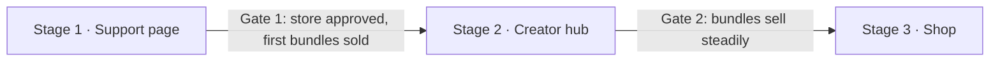

# Creator Support Site: Product Description

Andrei · Oct 17, 2026

## Overview

A personal creator site that lets Medium readers support Andrei by buying small pay-what-you-want digital extras, built to grow into a creator hub and a digital-product shop.

The problem: Medium Partner Program payouts and Buy Me a Coffee both rely on Stripe, which does not support sellers in Montenegro. The site replaces both with a checkout run by a merchant-of-record provider that does pay out to Montenegro.

The constraint that shapes the product: Paddle and Lemon Squeezy forbid pure donations. Every payment must therefore buy a real product. Support is framed as "get something useful, name your price," never as a tip jar.

## Goals and non-goals

Stage 1 succeeds when a reader can go from the end of a Medium article to a completed purchase in under a minute on a phone.

**Stage 1 goals**

- Receive reader support through a provider that pays out to Montenegro.
- Introduce Andrei and what readers get from his articles.
- Show which articles bring in supporters.
- Lay the foundations (domain, routes, data model, design system) for the hub and shop.
- Serve as a hands-on learning project for AI-assisted development with Claude Code.

**Non-goals for stage 1**

- A full shop, user accounts, or a members area.
- Hosting articles on the site itself.
- Subscriptions or recurring memberships.
- Languages other than English.

## Audience and traffic

The primary visitor is a warm reader who has just finished one of Andrei's Medium articles and clicked the support link at its end.

- **Who they are:** beginners and practitioners who want to build useful things with Python and AI, plus a smaller group interested in data architecture and governance.
- **What they already know:** Andrei's writing and tone. They don't need persuading from scratch.
- **Device:** mostly phones, often arriving from the Medium app.
- **What they need from the page:** confirmation they're in the right place, a quick sense of what they get, and a checkout with almost no friction.

Search and social traffic are secondary at launch and become more important once the articles hub exists.

## Positioning, voice and tone

Positioning: DIY guides for building useful things with Python and AI, complete enough to use today without other tutorials. Data architecture and governance is a secondary topic, shown as a tag, not in the headline.

**Identity:** built around Andrei's personal name plus a brand tagline. The name matches the Medium byline readers just saw. The "workshop" idea lives in the tagline and visuals. A shop sub-brand can come later if needed.

**Voice rules**

- More value, less padding in every line.
- Beginner-friendly, no jargon.
- Humorous, sometimes sarcastic, the same as in Andrei's articles.
- Personality lives in microcopy: buttons, thank-you page, empty states, 404.

**Tagline options** (recommended first)

1. DIY with me: useful things built with Python and AI, every step included.
2. Useful things you can build this weekend. Instructions included, fluff not.
3. Python and AI, explained so you can actually use it. Today, not after five more tutorials.

**Microcopy drafts** (drafted in Andrei's voice; review before launch)

| Placement | Copy |
| --- | --- |
| Hero headline | Useful things you can build this weekend. |
| Hero subhead | Step-by-step guides on Python and AI, written so you can finish the job without opening five other tutorials. |
| Hero buttons | Grab a cheat sheet · Read the articles |
| Greeting for visitors from an article | Fresh from "{article title}"? The cheat-sheet version is right below. You've earned it. |
| Support heading | Support my writing and get something useful back |
| Support intro | Medium can't pay me: its payment provider doesn't do Montenegro. So instead of a tip jar, here's a deal. You name the price, I send you the PDF and the cheat sheet. Everyone wins, especially my coffee machine. |
| Free-content note | Every article stays free on Medium. The bundle just saves you the scrolling. |
| Bundle card | {Article title}: PDF + cheat sheet. The full article as a clean PDF, plus one page with just the steps and commands. |
| Price field | Name your price. Minimum {min}, suggested {suggested}. Paying more is allowed and deeply appreciated. |
| Checkout button | Get the bundle |
| Bundle placeholder | New bundle cooking. Check back soon. |
| About heading | Who's writing this |
| About intro | I'm Andrei. For 25+ years I've designed data systems for banks and large companies, where "it mostly works" gets you a very long meeting. Now I write guides on building useful things with Python and AI, every step included, because I can't stand tutorials that skip the hard part. |
| Featured heading | Start with these |
| Featured card button | Read on Medium |
| Signup heading | Get new guides by email |
| Signup helper | One email when a new article is out. No spam, no weekly digest I'd forget to write. |
| Signup button | Notify me |
| Signup success | You're on the list. See you at the next article. |
| Signup error | That doesn't look like an email address. Try again, I'll wait. |
| Cookie consent bar | Cookies, but only the boring analytics kind. They tell me which articles bring you here. Buttons: Fine by me · No thanks |
| Checkout cancelled | Changed your mind? No hard feelings. The articles are still free. |
| Thank-you page | Payment received. My coffee machine thanks you personally. The download link is on its way to your inbox. |
| 404 page | This page doesn't exist. Unlike my articles, it skipped the details. Button: Back to the useful part |
| Footer | Made with Python, AI, and an unreasonable amount of coffee. |

## Support model and products

Readers support Andrei by buying an article bundle (a PDF edition plus a one-page cheat sheet) at a pay-what-you-want price with a minimum.

**Why products, not tips:** [Paddle](https://paddle.com/support/aup) prohibits donations and sponsorship, and [Lemon Squeezy](https://docs.lemonsqueezy.com/help/getting-started/prohibited-products) prohibits donations where no product exists or the price exceeds the product's value. Both review stores before activation.

**Product rules**

- Extras are convenience versions of free content: saved time and polish, never missing information. Articles stay complete on Medium.
- Each bundle is described as a product, with what's inside and who it helps.
- Pay-what-you-want with a minimum and a suggested price, both configurable per product rather than hard-coded.
- Launch with 2 to 3 bundles from the best-performing articles. During local development these are placeholders.

**Production:** bundles are generated from the article's Markdown source, ideally by a small Python utility that outputs both the PDF and the cheat sheet. That utility is itself a candidate DIY article.

**Provider:** Lemon Squeezy. It supports bundles and collections with different pricing variants, plus upsells and discounts on bundles, which covers the stage 3 shop too. Paddle stays as the fallback. Before going live, describe the bundle model to Lemon Squeezy support and confirm it's accepted.

## Launch page structure

One scrolling page with six sections. Each section is the starting version of a future page: later it gets its own route, and the home-page section becomes a short preview linking to it.

| # | Section | Content at launch | Grows into |
| --- | --- | --- | --- |
| 1 | Hero | Avatar, name, tagline, one-line promise, one call to action | Stays as the home page hero |
| 2 | Support block | 2 to 3 bundle cards, pay-what-you-want checkout, one line on why | /shop with more products |
| 3 | About the author | What readers get from the articles first, then a short career line and 2 to 3 topic tags | /about with the full story |
| 4 | Featured articles | The 3 best Medium articles as cards linking out | /articles hub on the own domain |
| 5 | Stay in touch | One-field email signup for new-article notifications | Newsletter |
| 6 | Footer | Contact, Medium and LinkedIn links, legal links | Legal pages (privacy, terms, refunds) |

**Page behavior**

- Mobile first. The support block appears within the first two screens on a phone.
- Visitors arriving from an article (read from `utm_campaign`) see a short line referencing the article they just read.
- The header holds up to five links but shows only two or three at launch.
- A small cookie consent bar sits at the bottom for EU visitors, without covering the support block.

Until the launch articles are chosen, bundle cards and featured article cards use placeholder content, so the whole page can be built and tested locally.

## Visual design direction

Sticker notebook is the base style. Friendly terminal is used wherever code appears.

**Sticker notebook (everything except code)**

- Warm off-white paper background, dark ink text, one readable sans-serif for body and headings.
- Highlighter marks on key phrases, rounded sticker-like tags with a slight tilt for topics and products.
- A handwritten accent font only for short asides ("psst, start here"), never for body text.
- A dark, rounded primary button.

**Friendly terminal (code only)**

- Code snippets, cheat-sheet previews and the 404 page use a dark monospace style.
- Jokes appear as code comments, keeping the no-jargon promise.

**Illustrated avatar**

- Made with AI assistance from Andrei's real photo and refined later. It must stay recognizable to Medium and LinkedIn readers.
- A small set of poses: waving (hero), holding coffee (thank-you page), confused (404).

**Design system first:** color tokens, type scale, spacing scale and core components (button, card, tag, product tile, code block) are defined before any page is built. Every page uses only these.

## SEO, analytics and referral tracking

SEO stays at solid basics for stage 1, because most visitors arrive by direct link from Medium. Heavier SEO work starts with the articles hub.

**SEO basics**

- Unique page title and meta description.
- Open Graph and social preview images, so shared links look good on LinkedIn and messengers.
- Clean URLs, HTTPS, a sitemap, and fast load on mobile.
- Structured data for the author (Person) and, later, for products.
- Each Medium article links to the site with its own UTM-tagged URL.

**Analytics**

- Google Analytics 4 from day one, chosen to avoid Vercel lock-in: it works the same on any host and has no plan dependency.
- GA4 sets cookies, so EU visitors see a consent banner and GA4 loads only after consent (Google Consent Mode). The banner is a small bottom bar in the notebook style, never a full-screen modal, so it doesn't stand between a warm visitor and the support block.
- Article links carry UTM parameters (`utm_source=medium`, `utm_medium=article`, `utm_campaign=<article-slug>`), which GA4 reports natively.
- One custom event, `checkout_click`, with parameters `article` and `bundle`, marked as a key event in GA4.
- Pass the article slug into the Lemon Squeezy checkout so each sale traces to the article that produced it.

## Technical and architecture requirements

The stage 1 site is small, but five decisions are made now so the hub and shop need no rebuild.

1. **Own domain from day one.** Every Medium link builds SEO value and recognition for an address kept permanently. The name must not mention coffee, tips or donations.
2. **Routes planned now.** Launch uses anchors (`/#support`, `/#about`). `/support`, `/about`, `/articles` and `/shop` are reserved, so links shared today never break.
3. **Support items are products in the data model.** A bundle is a product with a flexible price. The shop later means adding more products, not a second system.
4. **Payment provider behind a thin abstraction layer.** Checkout links, webhooks and product IDs sit in one module, so switching providers doesn't touch pages.
5. **Design system as code.** Tokens and components live in one place and are what Claude Code is pointed at when building each page.

**Hosting:** Vercel, as the Claude Code course requires. The free Hobby plan covers local and preview work while the site has placeholders and no live checkout. Vercel limits Hobby to non-commercial personal use and counts even donations as commercial, so the site moves to Pro ($20/month) before the first real checkout. Analytics runs on Google Analytics rather than Vercel Web Analytics, and other Vercel-only features are avoided, so a later move to another host stays simple.

Also required: English only, but text kept in content files rather than hard-coded, so a second language could be added later.

## Legal and compliance

Three short pages are needed before the provider approves the store: privacy policy, terms of sale, and refund policy.

- The privacy policy covers Google Analytics cookies, the email signup and data shared with the payment provider. A cookie consent banner is required before GA4 loads for EU visitors.
- Terms and refunds should match the merchant-of-record provider's own terms for digital goods.
- The footer links to all three from every page.

These are not legal advice. Have the final texts checked against Montenegrin and EU requirements.

## Roadmap

Each stage builds on the foundations of the one before.

| Stage | When | Scope | Gate to next stage |
| --- | --- | --- | --- |
| 1 · Support page | Now, in scope | One scrolling page; 2 to 3 article bundles; about and featured articles; email signup | Store approved, first bundles sold |
| 2 · Creator hub | Next | /about and /articles pages; start-here path for newcomers; newsletter; deeper SEO work | Bundles sell steadily, readers ask for more |
| 3 · Shop | Later | /shop with product pages; more digital products; same products data model and checkout layer | — |

Only stage 1 is in scope now. The gate criteria are proposals; refine them once real sales data exists.
